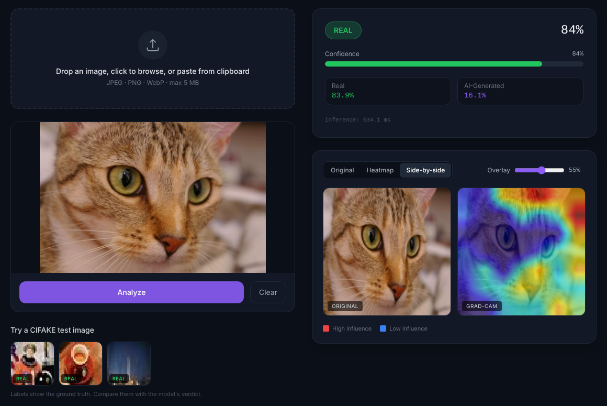
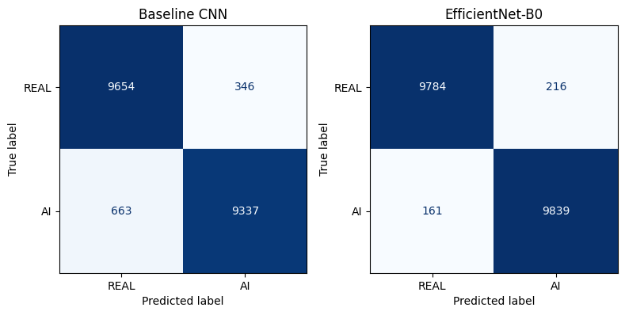
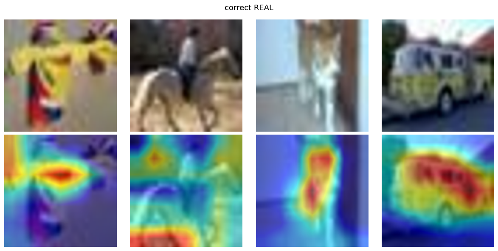
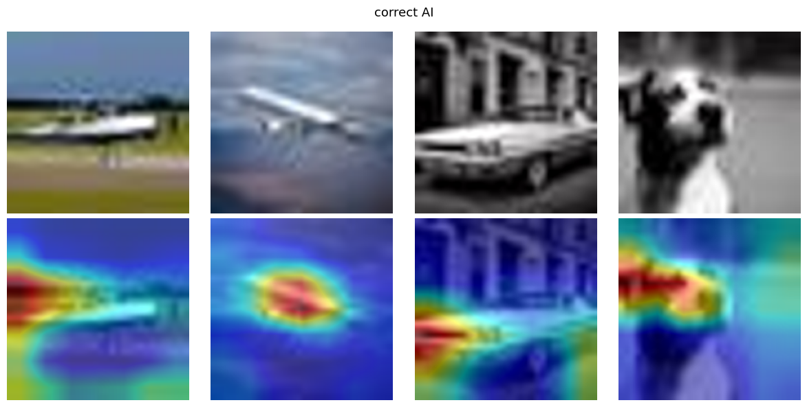
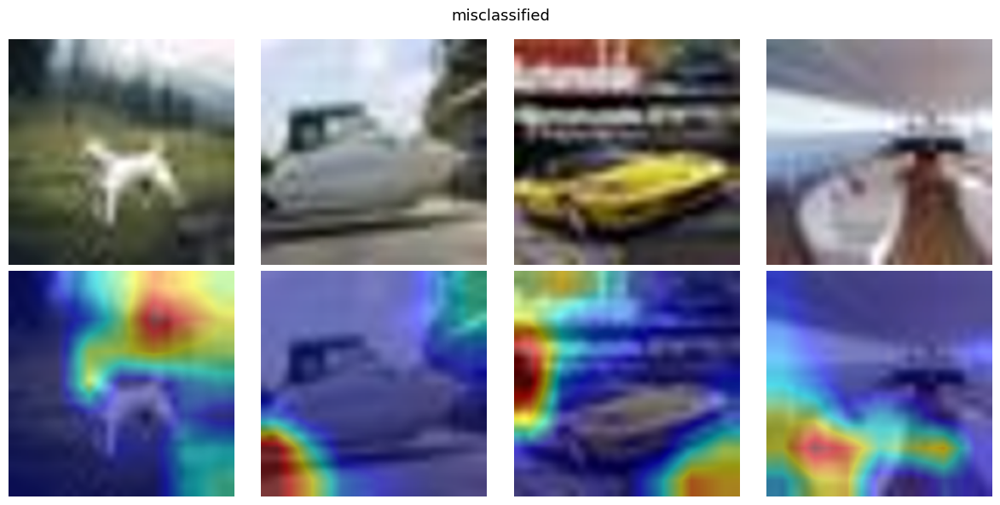

# AI Image Detector

Classifies an image as **REAL** or **AI-GENERATED**, gives a confidence score, and shows a **Grad-CAM heatmap** of the regions that drove the decision.



**In short:** a fine-tuned EfficientNet-B0 reaches **98.1% accuracy** on 20,000 held-out CIFAKE images, but drops to **49% (chance)** on modern AI images and real phone photos. It learned the fingerprints of one generator, not "AI-ness" in general. Both results are documented below.

## How it works

```
Image → resize 224×224 → EfficientNet-B0 (ImageNet-pretrained, fine-tuned) → sigmoid → REAL / AI-GENERATED
                                 └→ Grad-CAM on last conv block → heatmap overlay
```

- **Dataset:** [CIFAKE](https://www.kaggle.com/datasets/birdy654/cifake-real-and-ai-generated-synthetic-images): 120k images at 32×32. REAL = CIFAR-10 photos, AI = Stable Diffusion v1.4. Split 90k train / 10k validation / 20k test.
- **Baseline:** a small CNN trained from scratch (3 conv blocks, ~94k parameters) on native 32×32 images.
- **Main model:** EfficientNet-B0 trained in two stages:
  1. Backbone frozen, train only the new head (lr 1e-3). Validation accuracy plateaus at **~88%**.
  2. Unfreeze the last 3 blocks (lr 1e-4, early stopping). Accuracy jumps to **~98%**, with the best checkpoint at epoch 6.
- **Augmentation:** horizontal flip only, so generation artifacts are not washed out.

## Results (CIFAKE test set, 20,000 images)

| Model | Accuracy | Precision | Recall | F1 | ROC-AUC |
|---|---|---|---|---|---|
| Baseline CNN (from scratch) | 94.96% | 0.964 | 0.934 | 0.949 | 0.990 |
| **EfficientNet-B0 (transfer learning)** | **98.11%** | **0.979** | **0.984** | **0.981** | **0.998** |

Test-set errors fell from 1,009 to 377 (**63% fewer**). Missed AI images dropped from 663 to 161.



## Grad-CAM: where the model looks

| Correct REAL | Correct AI-GENERATED |
|---|---|
|  |  |

On correct predictions, attention sits on the subject. For AI images it focuses on edges and fine detail, where diffusion artifacts tend to appear.



On **misclassified** images, attention drifts to backgrounds and image borders. This suggests partial reliance on dataset-specific shortcuts. With 4 samples per grid it is an indication, not proof.

## Limitation: 98% → 49% on unseen images

The model was tested on 100 images it had never seen and that are not from CIFAKE: 50 from newer AI generators and 50 real phone photos.

| Unseen test set | Correct |
|---|---|
| Real phone photos | 17 / 50 (34%) |
| AI images from newer generators | 32 / 50 (64%) |
| **Overall** | **49 / 100 (49%)** |

Why:
1. **One generator.** It learned Stable Diffusion v1.4's traces. Newer generators leave different ones.
2. **Dataset bias.** The REAL class is small, old CIFAR-10 photos, so modern photos look unfamiliar and get pushed toward "AI".
3. **Resolution.** Everything was learned at 32×32, where most of the fine detail that separates real from AI is lost.

100 images is a small sample, so read this as "around chance level". Detecting AI images across generators is still an open research problem. This project is AI-generated *image* detection, not deepfake detection.

## Run it locally

The trained checkpoint (`models/effnet_b0_best.pt`, 16 MB) is included, so no training is needed.

**Backend** (FastAPI, CPU inference ~250 ms/image):
```bash
cd backend
pip install -r requirements.txt
uvicorn app:app --reload --port 8000
```

**Frontend** (React + Vite + Tailwind):
```bash
cd frontend
npm install
npm run dev
```
Open http://localhost:5173. The app includes CIFAKE test images to try.

Uploads are first downscaled to a 32×32 JPEG to match the training data. Set `MATCH_TRAINING_RES=0` to turn this off. The backend looks for the checkpoint in `$MODEL_PATH`, then `backend/models/`, then `models/`.

### API

| Endpoint | Method | Description |
|---|---|---|
| `/predict` | POST | Multipart image (field `file`) → label, confidence, class probabilities, heatmap |
| `/health` | GET | Status and model name |

## Retrain from scratch

Run the notebooks in order on Google Colab (T4 GPU). Each one downloads CIFAKE with `kagglehub` and saves its output to Google Drive.

1. `01_eda.ipynb`: class balance, sample grid, pixel histograms
2. `02_baseline_cnn.ipynb`: baseline CNN
3. `03_efficientnet_transfer.ipynb`: two-stage fine-tuning → `effnet_b0_best.pt`
4. `04_gradcam_and_eval.ipynb`: Grad-CAM grids, confusion matrices, comparison table, cross-generator test

## Deploy

- **Backend → Hugging Face Spaces (Docker):** copy `backend/` and `models/effnet_b0_best.pt` into a Docker Space. Track `*.pt` with `git lfs`, then push.
- **Frontend → Vercel:** set the root directory to `frontend` and `VITE_API_URL` to your Space URL.

## Project structure

```
├── backend/     FastAPI app, model loading, Grad-CAM
├── frontend/    React + Vite + Tailwind UI
├── models/      Trained checkpoint
├── notebooks/   EDA, training, evaluation
└── docs/        Figures used in this README
```

## Tech stack

PyTorch · torchvision · pytorch-grad-cam · scikit-learn · FastAPI · React · Vite · Tailwind CSS

## Team

Akshit Sonkusale, Chintha Vamsha Vardhan and Nehal Dhaka. Guided by Ms. B Jyothi, Dept. of Data Science, Anurag University, Hyderabad.
